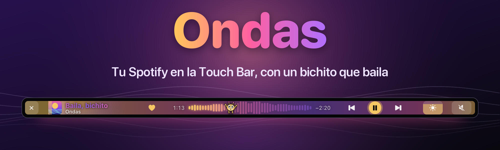
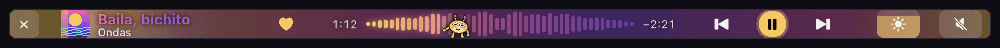
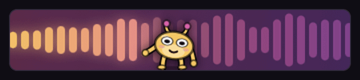
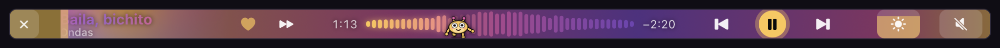
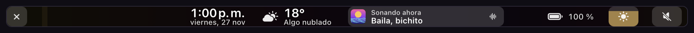
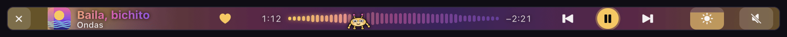

<p align="center">
  
</p>

<p align="center">
  <a href="https://github.com/sebastuxi/ondas-touchbar/releases/latest"></a>
  
  
  
</p>

<p align="center">
  
</p>

**Ondas** convierte la Touch Bar de tu MacBook Pro en un reproductor de Spotify con vida propia: la portada y la
canción con los colores del disco, un espectro de barras que se mueve con la música de verdad (y sirve de barra de
progreso) y un bichito que improvisa pasos encima.

<p align="center">
  <a href="https://github.com/sebastuxi/ondas-touchbar/releases/latest"><b>⬇️ Descargar Ondas para Mac</b></a>
  &nbsp;·&nbsp; <a href="#instalar">Cómo instalarla</a>
  &nbsp;·&nbsp; <a href="#in-english">English</a>
</p>

## ✨ Lo que hace

### 🕺 Un bichito que baila contigo

<p align="center"></p>

Tiene 20 pasos (saltitos, disco, robot, twist, palmas, olas…) y en cada compás elige el siguiente según lo que suena:
energía, graves o agudos, estribillo o estrofa y ánimo. Si la canción explota, salta o gira; si se calma, baja el ritmo;
con canciones tristes se pone triste, con lagrimita y todo. Toma el color de la portada y cada canción tiene su propia
coreografía. Tócalo y se ríe; arrástralo y te lo llevas por la canción.

### 🌊 Barras que se mueven con la música real

Ondas escucha el sonido de Spotify (no graba nada) y las barras se mueven con cada golpe. Toda la barra se ilumina con
los colores de la portada: más brillo en lo fuerte y un destello suave en los golpes, como mucho 3 por segundo para
cuidar la vista. Toca o arrastra sobre las barras para moverte por la canción.

### 👆 Desliza para cambiar de canción

<p align="center"></p>

Desliza la foto o el nombre: a la izquierda pasa a la siguiente y a la derecha vuelve a la anterior. Si sueltas antes
de tiempo, la canción vuelve a su sitio.

### ☀️ Reposo con hora, clima y batería

<p align="center"></p>

Con la X, sin música o tras un minuto en pausa: hora y fecha (toca para abrir Calendario), clima (toca para abrir
Tiempo), lo que suena y la batería.

### 🔋 Una ola verde al enchufar el cargador

<p align="center"></p>

La ola llena la barra hasta tu porcentaje de batería y vuelve sola a lo de antes.

### Y además

- ❤️ **Me gusta:** el corazón guarda o quita la canción de tus «Me gusta» de Spotify.
- ⌨️ **Ondas al escribir:** con cada tecla, la luz del teclado sube suave y sale una onda de color en la Touch Bar,
  justo encima de la tecla que pulsaste.
- 🔆 **Brillo y volumen** propios: al tocarlos, la barra se vuelve un deslizador grande.
- 🚀 Se abre sola cuando Spotify está al frente y al encender la Mac (se puede quitar en el menú ≋).

## Instalar

**Necesitas** una MacBook Pro con Touch Bar con macOS 14.2 o posterior (modelos de 2018 en adelante) y la app de
Spotify. La descarga trae la versión para Intel y para Apple Silicon.

### Opción 1: descargar (lo más fácil)

1. Baja **Ondas.zip** de la [última versión](https://github.com/sebastuxi/ondas-touchbar/releases/latest) y descomprímelo.
2. Arrastra **Ondas.app** a tu carpeta **Aplicaciones**.
3. Ábrela. Como la app no está firmada por Apple, la primera vez macOS no la deja abrir: ve a
   **Ajustes del Sistema → Privacidad y seguridad**, baja hasta el aviso de Ondas y pulsa
   **Abrir igualmente** («Open Anyway»). En macOS 14 también sirve clic derecho → Abrir.

¿Prefieres la Terminal? Esto quita el bloqueo y luego la abres normal:

```sh
xattr -dr com.apple.quarantine /Applications/Ondas.app
```

### Opción 2: compilarla tú

Necesitas Xcode o solo las herramientas de línea de comandos (`xcode-select --install`).

```sh
git clone https://github.com/sebastuxi/ondas-touchbar.git
cd ondas-touchbar
./scripts/install.sh            # compila, copia a ~/Applications/Ondas.app y la abre
```

`./scripts/build-app.sh` solo compila (deja la app en `build/Ondas.app`) y `./scripts/release.sh` arma el
`Ondas.zip` universal para publicar. Para que macOS recuerde los permisos aunque vuelvas a compilar, firma con tu
certificado de desarrollo:

```sh
security find-identity -v -p codesigning            # copia el código largo de tu certificado
ONDAS_SIGN_IDENTITY=<código> ./scripts/install.sh
```

## 🔐 Permisos y privacidad

macOS pide cada permiso una vez. Ondas no tiene cuentas ni servidores propios, y si dices que no a un permiso,
solo se apaga lo que lo necesita.

- **Automatización → Spotify:** leer qué suena, pausar, cambiar de canción y adelantar.
- **Grabación de audio del sistema:** escuchar el sonido de Spotify para mover las barras. No se graba ni se guarda
  nada. Sin este permiso, las barras se mueven con un ritmo simulado.
- **Ubicación:** solo para el clima del reposo. Se redondea a ~1 km y solo se envía a
  [Open-Meteo](https://open-meteo.com) (gratis, sin cuenta). Sin este permiso, el reposo muestra la hora y la música,
  sin clima.
- **Monitorización de entrada:** para las ondas al escribir. Ondas solo usa la posición de cada tecla; no lee, guarda
  ni envía lo que escribes.

## ❤️ Conectar «Me gusta»

Es opcional y se hace una vez: menú ≋ → **Conectar «Me gusta» de Spotify…**. Crea una app gratis en
<https://developer.spotify.com/dashboard> con la Redirect URI `http://127.0.0.1:8721/callback`, marca «Web API» y pega
su Client ID. El token queda en tu Llavero.

## 🎛️ Más detalles

<details>
<summary>Cómo se usa cada parte</summary>

- La barra se abre sola cuando Spotify está al frente y se recoge al cambiar de app.
- La X cuadrada de la izquierda (va en el sitio de Esc): con música pasa a la pantalla de reposo; en reposo
  cierra Ondas. Se vuelve a abrir con el botón de Ondas en la Control Strip, con el menú ≋ o al darle play.
- El bichito hace de cabezal sobre la barra de progreso. Además de sus pasos, rebota con cada bombo y mueve los brazos
  con los platillos; en pausa se sienta y mira el play. Se quita en el menú ≋ → «Bichito bailando». Necesita que la
  música suene en la Mac: si Spotify suena en otro dispositivo, baila con un pulso tranquilo.
- Al enchufar el cargador, la ola tarda unos 2.5 s; si tocas la barra, se quita al instante.
- En el deslizador de volumen, el altavoz de la izquierda activa o quita el silencio. Vuelve sola a la canción a los 2.5 s.
- Toca la foto o el nombre para abrir Spotify.
- Menú ≋ en la barra de menús: mostrar la barra, abrir sola con Spotify, barras con la música real, bichito bailando,
  ondas al escribir, abrir al encender la Mac, «Me gusta» y salir.

</details>

<details>
<summary>Para desarrolladores</summary>

Ondas usa la API privada de la Touch Bar (`presentSystemModalTouchBar`, la misma que usan MTMR y Pock) para
mostrarse encima de cualquier app. Apple podría cambiarla en futuras versiones de macOS.

Para revisar el diseño sin tocar la barra (capturas con `screencapture -b`), ábrela con una vista previa:

```sh
open ~/Applications/Ondas.app --args -OndasPreview demo,fast       # canción de ejemplo con el bichito bailando
open ~/Applications/Ondas.app --args -OndasPreview idle,weather    # también: swipe, charging
open ~/Applications/Ondas.app --args -OndasPreview fast            # bichito: dance, calm, bass, fast, bright, sad, moves, sit, carry
```

`demo` muestra una canción de ejemplo con su propia portada y no le manda nada a Spotify. Con `weather` el clima es
de ejemplo (no se pide el real). Para volver a lo normal, ciérrala y ábrela sin `--args`.

Opcional, para quitar Siri de la Control Strip:

```sh
defaults write com.apple.controlstrip MiniCustomized -array com.apple.system.brightness com.apple.system.volume com.apple.system.mute
killall ControlStrip
```

Para recuperarlo: `defaults delete com.apple.controlstrip MiniCustomized && killall ControlStrip`.

</details>

## In English

**Ondas** turns the Touch Bar of your MacBook Pro into a lively Spotify player: album art and song title in the
colors of the cover, a spectrum that moves with the real audio (and doubles as a progress bar), and a little critter
that improvises dance moves on top. It also has an idle screen with time, weather and battery, swipe to skip songs,
a charging animation and typing ripples. The interface is in Spanish.

**Install:** download `Ondas.zip` from the [latest release](https://github.com/sebastuxi/ondas-touchbar/releases/latest),
move `Ondas.app` to Applications and, the first time, allow it in **System Settings → Privacy & Security → Open
Anyway** (the app isn't notarized by Apple). Requires a Touch Bar MacBook Pro with macOS 14.2 or later.

---

Datos del clima: [Open-Meteo.com](https://open-meteo.com) (licencia CC BY 4.0).
